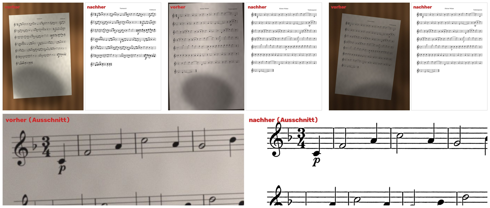

# Noten-Scanner

Macht aus Handyfotos und Scans von Notenblättern saubere, druckfertige Seiten –
gedacht, um viele Noten eines Vereins auf einmal zu digitalisieren.



## Was das Programm macht

Für jedes Foto, ganz automatisch:

1. **Blatt finden und entzerren** – das Notenblatt wird im Foto gesucht, ausgeschnitten
   und perspektivisch gerade gezogen (auch wenn das Handy schräg gehalten wurde). Jede
   Blattseite wird dabei einzeln an der echten Papierkante ausgerichtet – das klappt auch
   auf Fliesenböden mit Fugen oder neben glänzenden Flächen.
2. **Einheitliche Größe** – Ergebnis ist A4 mit 300 dpi (andere Formate wie
   Marschbuch-Größe behalten ihr Seitenverhältnis).
3. **Licht ausgleichen** – Schatten von Handy oder Hand, ungleichmäßiges Licht,
   vergilbtes oder farbiges Papier verschwinden.
4. **Richtig herum drehen** – quer oder kopfüber fotografierte Seiten werden erkannt
   (an der Richtung der Notenlinien und an den Notenschlüsseln am Zeilenanfang) und
   gedreht. Das passiert oft, wenn das Handy flach über einem Blatt auf dem Boden liegt.
   Außerdem wird die Schräglage an den Notenlinien gemessen und korrigiert.
5. **Hintergrund reinweiß, Noten tiefschwarz** – auch dünne Notenlinien, die im Foto nur
   noch grau sind, bleiben vollständig erhalten.
6. **Aufräumen** – dunkle Ränder, Tischkanten, Finger und Schatten am Blattrand,
   Staub und Kopierflecken werden entfernt. Staccato-, Verlängerungs- und
   Wiederholungspunkte bleiben dabei erhalten.
7. **Notenlinien, Hälse und Taktstriche nachziehen** – bei alten Kopien und unscharfen
   Fotos sind Linien oft unterbrochen, mal dünner, mal dicker. Das Programm erkennt die
   Notensysteme, folgt dem Verlauf jeder Linie und zieht sie durchgehend in gleichmäßiger
   Dicke neu. Hälse und Taktstriche werden ebenso begradigt. Notenköpfe, Balken, Bögen,
   Schlüssel, Vorzeichen und Text bleiben dabei unangetastet.
   Eine **Selbstkontrolle** vergleicht danach Vorher und Nachher: Wurde irgendwo eine Linie
   gezeichnet, wo im Original keine Tinte ist, oder mehr entfernt als nur Linienfransen
   (z. B. ein Balken), bleibt diese Stelle wie im Original – das Protokoll meldet das.
8. Auf Wunsch: **Bleistift-Eintragungen entfernen**.
9. **Speichern** als PNG und als PDF (ein PDF pro Ordner, z. B. pro Stück).

Unterordner werden mit verarbeitet, die Ordnerstruktur wird im Ergebnis nachgebaut.
Eingelesen werden JPG, PNG, TIFF, BMP, WEBP, HEIC (iPhone) und PDF (z. B. aus
Scanner-Apps).

## Handy-App (iPhone)

Der Noten-Scanner läuft auch als App direkt auf dem iPhone – ohne App Store, ohne Server:
Die Fotos werden auf dem Handy selbst bereinigt und verlassen es nicht.

**Einrichten (einmalig):**
1. Die Adresse der App (z. B. `https://<name>.github.io/noten-scanner/`) in **Safari** öffnen.
2. Unten auf das Teilen-Symbol (Quadrat mit Pfeil) tippen → **„Zum Home-Bildschirm“**.
3. Die App vom Home-Bildschirm aus starten. Beim ersten Start lädt sie ca. 30 MB
   (Python und die Bildverarbeitung) – danach funktioniert sie auch ohne Internet.

**Benutzen:**
1. **„Seite fotografieren“** (Kamera) oder **„Aus Fotos wählen“** (mehrere auf einmal).
   Jede Seite wird sofort im Hintergrund bereinigt (je nach iPhone ca. 10–30 Sekunden),
   du kannst währenddessen weiter fotografieren.
2. Reihenfolge mit ◀ ▶ anpassen, misslungene Seiten mit 🗑 entfernen. Antippen zeigt die
   Seite groß – mit „Vorher“ lässt sie sich mit dem Foto vergleichen.
3. Namen eingeben, **„PDF erstellen“**, dann **„Teilen / Sichern …“**: Darüber lässt sich
   das PDF in der Dateien-App sichern, per WhatsApp oder Mail verschicken oder in einen
   Cloud-Ordner (iCloud, Google Drive, Nextcloud, Dropbox …) legen.
4. **„Neues Stück beginnen“** leert die Liste. Bis dahin bleiben die Seiten erhalten,
   auch wenn die App zwischendurch geschlossen wird.

Unter ⚙︎ gibt es dieselben Einstellungen wie am PC (Darstellung, Linien nachziehen,
Bleistift entfernen, Empfindlichkeit) und die Qualität: „Sparsam (200 dpi)“ ist schneller
und braucht weniger Speicher – sinnvoll für ältere iPhones. Wird der Speicher bei 300 dpi
knapp, wiederholt die App die Seite automatisch mit 200 dpi.

**Veröffentlichen/aktualisieren:** Die App liegt in `app/`. Bei jedem Hochladen auf
GitHub (Branch `main`) baut `.github/workflows/pages.yml` sie automatisch und
veröffentlicht sie über GitHub Pages (einmalig unter *Settings → Pages → Source:
GitHub Actions* einschalten). Lokal bauen: `python app/bauen.py` → Ordner `app/www`,
der sich auch auf jeden anderen Webspace mit https hochladen lässt.

## Noten erkennen, korrigieren, anhören, transponieren – Vereins-Bibliothek

Aus den bereinigten Seiten kann die App die Noten **lesen und neu setzen** (ähnlich wie
neumascan, aber auf dem eigenen Vereins-Server und ohne Kosten pro Seite):

1. Nach dem Fotografieren **„🎼 Noten erkennen und neu setzen“** tippen. Die Seiten gehen an
   den Vereins-Server; nach etwa einer halben bis einer Minute pro Seite erscheint die Partitur.
   **Titel, Stimme und Instrument** liest der Server aus dem Kopf der ersten Seite; wer selbst
   einen Namen eintippt, behält seinen. Ändern lässt sich beides beim Speichern.
2. **Takte prüfen:** Takte, bei denen die Erkennung unsicher war oder die Taktlänge nicht
   stimmt, sind **gelb** hinterlegt, automatisch korrigierte **blau**. Einen Takt antippen
   zeigt das **Original aus dem Foto** und darunter die gelesene Fassung. Jede Note lässt sich
   ändern (höher/tiefer, ♭ ♮ ♯, Notenwert, Punkt, Triole, Pause, einfügen, löschen, dazu
   Staccato, Tenuto, Akzent, Marcato, Keil und Fermate an- und ausschalten); die
   Taktprüfung meldet sofort, ob der Takt aufgeht. „✓ Stimmt so“ nimmt die Markierung weg.
   Der Original-Ausschnitt zeigt den ganzen Takt mit beiden Taktstrichen. Fehlt ein Takt oder
   ist einer zu viel: **„+ Takt danach“** und **„Takt löschen“**; bei einer Mehrtaktpause lässt
   sich die Länge mit − und + ändern. **„Text …“** zeigt die Textangaben und Studierzeichen des
   Takts – löschen oder neue eintragen („Trio“, „rit.“, „D.C. al Fine“; ein einzelner
   Großbuchstabe oder eine Zahl wird ein eingerahmtes Studierzeichen).
3. **▶ Abspielen:** Das Stück erklingt (klingende Tonhöhe des Instruments), die gespielte
   Note wird rot markiert; Staccato klingt kurz, Akzente lauter. **Wiederholungen und Volten
   werden mitgespielt.** Während des Abspielens einen Takt antippen springt dorthin; im
   Takt-Fenster startet „▶ Ab hier“ ab diesem Takt. Tempo unter „⋯“.
4. **Transponieren:** „Diese Stimme ist für …“ (z. B. B-Trompete) und „Anzeigen für …“
   (z. B. Es-Horn, Horn in F, Posaune im Bassschlüssel). Die Lage im Notensystem wird
   automatisch passend gewählt.
5. **PDF:** sauber gesetzt (A4), auch transponiert. Unter „⋯“ zusätzlich **MusicXML** für MuseScore.
6. **Speichern:** legt das Stück in der **Vereins-Bibliothek** ab (Titel, Stimme, Instrument,
   Komponist). Alle Mitglieder mit dem Vereinskennwort können dort suchen, öffnen, anhören,
   transponieren und drucken (📚 oben in der App).

Die Erkennung baut auf [homr](https://github.com/liebharc/homr) auf und ergänzt eigene
Prüfungen (Taktlänge je Taktart, Taktwechsel, Schlüssel, Tonartwechsel, Vorzeichen bis Taktende,
Faulenzer, Mehrtaktpausen, Pausenform, Artikulationen, Wiederholungen, Volten und Texte am Bild,
Gegenprobe am Bild). Auf 5 Testseiten des
Vereins: 99,5 % der Noten richtig (homr allein: 91,7 %). Diese Seiten wurden auch zum Entwickeln benutzt; eine
neue Seite („Lummerland“) lag vor der Anpassung bei 92,6 %, danach bei 99,3 % – auf ganz neuen
Seiten ist trotzdem mit Fehlern zu rechnen, deshalb die Prüf- und Korrekturfunktion.
**Faulenzer** (Takt-Wiederholungszeichen, auch über zwei Takte) werden erkannt und beim Abspielen
mitgespielt. **Staccato, Tenuto und Akzente** werden am Bild nachgeprüft (homr verwechselt Punkt und
Strich oft): auf einer Testseite 100 % statt 76 %, auf dem Lummerland-Foto 95 % statt 60 %; was
fehlt, lässt sich im Takt-Editor mit einem Tippen setzen. Sonderzeichen wie der Stampfer werden
noch nicht erkannt.

**Wiederholungszeichen und Volta-Klammern** werden am Bild gelesen (dicker Taktstrich mit zwei
Punkten, Klammerlinie mit Haken und Zahl); homr allein setzte den Wiederholungsanfang auf die
falsche Seite des Takts und übersah Klammern. Auf den vier Testseiten mit Wiederholungen stimmen
jetzt alle 55 Zeichen und Klammern (vorher 33). **Textangaben** („Trio“, „Fine“, „D.C. al Fine“,
„dolce“, Tempo) und **eingerahmte Studierzeichen** (A, B, C … oder Taktzahlen) liest eine
Texterkennung mit und setzt sie an ihren Takt. Sprünge wie „D.C. al Fine“ stehen als Text da,
werden beim Abspielen aber noch nicht befolgt. **Bindebögen**, denen homr Anfang oder Ende
verloren hat (oft am Zeilenwechsel), werden nach dem Muster gleich gebauter Takte geschlossen
oder entfernt – sonst zöge der Notensatz einen Bogen über die halbe Seite. Alle diese Regeln
sind an denselben sechs Seiten abgestimmt, an denen sie gemessen wurden; bei anderen
Notenschriften ist mit Fehlfunden zu rechnen (falsche Texte lassen sich unter „Text …“ löschen).

### Vereins-Server einrichten (einmalig, kostenlos)

Der Server läuft als kostenloser **Hugging Face Space** (2 Prozessorkerne, 16 GB Speicher).
Nach längerer Pause schläft er ein; der erste Aufruf danach dauert 1–2 Minuten.

1. Konto bei [huggingface.co](https://huggingface.co/join) anlegen. Unter
   *Settings → Access Tokens* einen Token mit der Rolle **Write** erstellen.
2. Im GitHub-Repository unter *Settings → Secrets and variables → Actions* eintragen:
   - **Secret** `HF_TOKEN` – der Token von Hugging Face
   - **Secret** `VEREIN_KENNWORT` – ein selbst gewähltes Kennwort für den Verein (Pflicht: ohne
     Kennwort nimmt der Server im Internet keine Aufträge an)
   - **Variable** `HF_SPACE` – z. B. `meinname/noten-scanner` (Hugging-Face-Name/Space-Name)
3. Unter *Actions* „Server zu Hugging Face“ starten (läuft danach bei jeder Änderung von
   selbst). Der Space wird angelegt und gebaut (beim ersten Mal ca. 10–15 Minuten). Die
   Bibliothek liegt in einem **privaten** Datensatz `meinname/noten-bibliothek`.
4. Danach „Handy-App veröffentlichen“ einmal neu starten: Die App kennt dann die
   Server-Adresse. Jedes Mitglied gibt in der App unter ⚙︎ nur noch das **Vereinskennwort** ein.

Lokal testen: `cd server && pip install -r requirements.txt && homr --init &&
VEREIN_KENNWORT=test uvicorn app:app --port 7860`, in der App als Server-Adresse
`http://<rechner>:7860` eintragen.

## Installation

Einmalig wird **Python 3.10 oder neuer** benötigt.

**Windows**
1. Python von <https://www.python.org/downloads/> installieren.
   Wichtig: im Installer den Haken bei **„Add python.exe to PATH“** setzen.
2. Diesen Ordner irgendwohin kopieren, z. B. auf den Desktop.
3. Doppelklick auf **`Start-Windows.bat`**. Beim ersten Start wird alles Nötige
   automatisch installiert (dauert ein paar Minuten, braucht Internet). Danach öffnet
   sich das Programmfenster – ab dann startet es sofort.

**Mac / Linux**
1. Python 3 installieren (Mac: von <https://www.python.org/downloads/>; Linux: meist
   schon vorhanden, unter Ubuntu/Debian zusätzlich `sudo apt install python3-tk python3-venv`).
2. Im Terminal: `sh start-mac-linux.sh`

**Von Hand** (für alle, die sich mit Python auskennen):
```
pip install -r requirements.txt
python noten_scanner_gui.pyw        # mit Fenster
python noten_scanner.py --help      # Kommandozeile
```

## Benutzung mit Fenster

1. **Ordner wählen …** (oder einzelne Dateien) – rechts erscheint sofort eine
   Vorschau *vorher/nachher*. Mit ◀ ▶ kann man durch die Fotos blättern.
2. Zielordner prüfen (Standard: neben dem Eingabeordner, mit `_bereinigt` am Ende).
3. Einstellungen bei Bedarf anpassen und mit **Vorschau berechnen** prüfen.
4. **Alle bereinigen** – fertig. Mit **Ergebnisordner öffnen** sieht man das Ergebnis.

## Benutzung über die Kommandozeile

```
python noten_scanner.py Fotos/
```
bereinigt alle Bilder im Ordner `Fotos` (mit Unterordnern) nach `Fotos_bereinigt`
und erstellt ein PDF pro Ordner.

Weitere Beispiele:
```
# nur PDFs in reinem Schwarz/Weiß (sehr kleine Dateien, ca. 30 KB pro Seite)
python noten_scanner.py Fotos/ -o Archiv/ --modus hart --nur-pdf

# Bleistift entfernen, Flecken stärker entfernen
python noten_scanner.py Fotos/ --bleistift-entfernen --entrauschen 2

# große Sammlung nach und nach: bereits Bearbeitetes überspringen
python noten_scanner.py Fotos/ --nur-neue
```
Alle Optionen: `python noten_scanner.py --help`

## Empfohlene Ordnerstruktur

```
Noten/
├── Florentiner Marsch/
│   ├── 1. Trompete.jpg
│   ├── 2. Trompete.jpg
│   └── Tuba.jpg
└── Böhmischer Traum/
    ├── Seite 1.jpg
    └── Seite 2.jpg
```
Ergebnis mit `--pdf ordner` (Standard): `Florentiner Marsch.pdf` mit allen Stimmen,
`Böhmischer Traum.pdf` mit beiden Seiten. Die Seiten werden „natürlich“ sortiert
(Seite 2 vor Seite 10). Soll jedes Foto ein eigenes PDF werden (z. B. eine Datei pro
Stimme), `--pdf datei` bzw. im Fenster „Ein PDF pro Foto“ wählen.

## Einstellungen

| Einstellung | Bedeutung |
|---|---|
| **Darstellung** | *Glatt* (Standard): reinweißer Hintergrund, tiefschwarze Noten, Kanten leicht geglättet – sieht auf Tablet und Bildschirm am besten aus. *Reines Schwarz/Weiß*: nur zwei Farben, kleinste Dateien, ideal zum Archivieren und Drucken. |
| **Empfindlichkeit** | Höher (z. B. 0.9): auch sehr blasser Druck alter Kopien bleibt erhalten. Niedriger (z. B. 0.6): nur kräftig Gedrucktes bleibt, mehr Schmutz und Grauschleier verschwinden. |
| **Flecken entfernen** | *Normal* reicht meistens. *Stark*/*Sehr stark* für stark verschmutzte Kopien – dann aber prüfen, ob kleine Punkte (Staccato) noch da sind. |
| **Notenlinien nachziehen** | Standardmäßig an. Wer die Linien genau so haben möchte wie im Original (z. B. bei Handschriften), schaltet es aus (`--linien-original`). |
| **Bleistift entfernen** | Entfernt frei stehende Bleistift-Eintragungen (Fingersätze, Zahlen, Kreise). Bleistift, der Noten oder Notenlinien berührt, oder sehr kräftig aufgedrückter Bleistift kann bleiben. |
| **Papierformat** | *Automatisch*: A4, wenn das Blatt ungefähr A4 ist, sonst Seitenverhältnis beibehalten. *Originalgröße*: keine Größenänderung. |
| **Blatt entzerren** | Bei Flachbettscans oder bereits zugeschnittenen Bildern schadet es nicht, kann aber ausgeschaltet werden. |

## Tipps für gute Fotos

- **Untergrund dunkler als das Papier** (Tisch, Fliesenboden, Tuch): dann findet das
  Programm die Blattkanten zuverlässig. Auf einem weißen Tisch klappt das Entzerren oft
  nicht – die Seite wird dann trotzdem bereinigt, bleibt aber leicht verzerrt.
- **Ganzes Blatt im Bild**, mit etwas Rand rundherum.
- **Handy möglichst parallel** zum Blatt halten, von oben fotografieren.
- **Gleichmäßiges Licht**, kein Blitz (Spiegelungen!). Schatten – auch der scharfe
  Schatten des eigenen Handys – gleicht das Programm aus, aber sehr dunkle Bereiche
  verlieren Details.
- **Originalfotos verwenden** – Fotos, die per WhatsApp & Co. verschickt wurden, sind
  stark verkleinert und komprimiert. Das Programm kommt damit zurecht, aber die Qualität
  ist schlechter.
- Scanner-Apps (z. B. die Scan-Funktion der Notizen-App, Microsoft Lens, Adobe Scan)
  funktionieren ebenfalls gut – auch deren PDFs können direkt eingelesen werden.

## Grenzen

- Stark gewölbte Seiten (Buchfalz eines dicken Notenbuchs) werden nicht geglättet –
  dafür das Buch möglichst flach drücken.
- Seiten ganz ohne Notenlinien (z. B. reine Textseiten) werden nicht automatisch um
  90°/180° gedreht – dafür fehlen die Anhaltspunkte.
- Siehe auch die Hinweise zu Bleistift und hellem Tisch oben.

Bei Seiten, auf denen keine Notenlinien erkannt wurden (z. B. Textseiten), steht im
Protokoll ein Hinweis – diese am besten kurz ansehen.

## Für Entwickler

```
notenscanner/
├── seite.py         Blatt im Foto finden, Perspektive entzerren
├── verarbeitung.py  Bereinigung: Licht, Schräglage, Schwarz/Weiß, Aufräumen
├── linien.py        Notenlinien, Hälse und Taktstriche erkennen und neu ziehen
├── dateien.py       Laden (EXIF, HEIC, PDF) und Speichern (PNG, PDF)
├── stapel.py        Stapelverarbeitung, parallel auf mehreren Prozessorkernen
├── pdf.py           schlanker PDF-Schreiber (für die Handy-App)
├── web.py           Schnittstelle für die Handy-App (Pyodide im Browser)
├── cli.py           Kommandozeile
└── gui.py           Fenster (tkinter)
app/
├── quelle/          Handy-App: index.html, app.js, worker.js (Python im Browser), sw.js (offline),
│                    partitur.js (Erkennung, Korrektur, Abspielen, Bibliothek), notenxml.js
│                    (MusicXML bearbeiten), instrumente.js (Transposition), klang.js (Web Audio)
├── bauen.py         baut die App nach app/www (holt Verovio 6.4.0 von npm)
└── test/            Browser-Tests (Playwright): test.js, test_partitur.js, test_notenxml.js,
                     test_takte.js, test_texte.js, test_faulenzer.js, test_artikulation.js
notenleser/          Notenerkennung: homr + eigene Prüfungen (notenleser.py, bildpruefung.py),
                     Prüfstand mit Grundwahrheit (pruefstand.py), Werkzeuge zur Fehlersuche
server/              Vereins-Server (FastAPI): app.py, erkennung.py, satz.py (PDF), ablage.py
                     (Bibliothek lokal/Hugging Face), Dockerfile, tests/
```

Die Notenerkennung (Ordner `notenleser/` und `server/`) baut auf homr auf und steht deshalb
unter der **AGPL-3.0**. Der Notensatz verwendet [Verovio](https://www.verovio.org) (LGPL).

Die Handy-App benutzt dasselbe Python-Paket wie das PC-Programm, im Browser über
[Pyodide](https://pyodide.org) 0.27.7 (numpy 2.0.2, OpenCV 4.10). Die Tests in
`tests/test_web.py` sollten deshalb zusätzlich mit genau diesen Versionen laufen.

Tests (erzeugen künstliche Notenblätter und simulieren Handyfotos mit Perspektive,
Schatten, Rauschen, Kopierflecken und Bleistift):
```
pip install pytest
python -m pytest tests
```
`tests/testdaten.py` kann mit `verovio` und `cairosvg` zusätzlich echte Notensätze
rendern. Mit `--zwischenschritte` speichert das Programm die einzelnen
Verarbeitungsschritte zur Fehlersuche.
